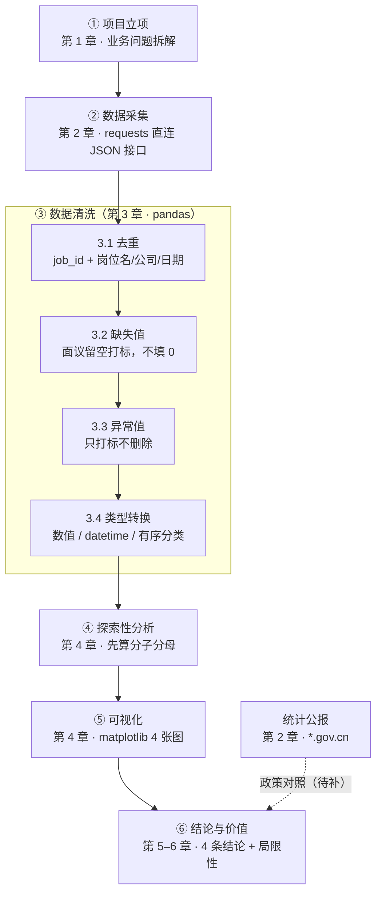

# 发布材料与面试准备（第 6 步）

> 所有内容基于第 5 步报告，不另起一套说法。数字全部沿用【】占位，回填时三处（报告/简历/口述）要一起改。

---

## 一、GitHub Pages 发布说明

已经生成两个文件：

| 文件 | 作用 |
|---|---|
| `README.md` | 仓库首页，含项目名、一句话简介、技术栈、结构树、复现步骤、图表预览说明、License |
| `docs/report.md` | 报告正文，带目录锚点、代码块语言标注、图表位置占位 |

**上线步骤（3 步）**

1. 把 `job-data-cy/` 整个目录推送成一个 GitHub 仓库
2. 仓库 Settings → Pages → Source 选 `Deploy from a branch` → 分支 `main`、目录 `/docs`
3. 等一分钟，访问 `https://<你的用户名>.github.io/<仓库名>/report.html`

**发布前必做两件事**

- `figs/` 里的 4 张 PNG 要真的提交上去，`docs/report.md` 里那行被注释掉的 `` 取消注释后路径要能对上（相对于 `docs/`，图在上一级，所以写成 `../figs/fig1_skills_top20.png`）
- `data/` 不要提交原始 CSV，加 `.gitignore`，只保留清洗脚本和图。合规声明里写了「不批量公开原始数据」，代码里就得做到

---

## 二、2 分钟口述稿（纯汉字约 335，含标点约 426，正常语速约 1 分 55 秒）

> 背的时候按时间点切，不要一口气背完。每段停顿半秒，让面试官有时间消化。
> 【】里的数字回填后要一起数一遍字数，别超 400。

**0:00–0:15 ｜ 业务问题**

我是专科大数据专业，秋招要在数据分析、数据开发、数据标注里选一个。网上说法多是全国本科口径，我干脆自己采了批川渝岗位数据，用数字定方向。

**0:15–0:45 ｜ 技术链路**

流程五步：requests 采四川人才网的官方接口，pandas 洗成十个字段，EDA 先把每张图的分子分母算清，matplotlib 出四张图，最后把图读成结论。工具很保守，因为每行代码我都解释得清。

**0:45–1:30 ｜ 关键发现**

三个发现。第一，技能要求集中，排第一的技能【X】% 的岗位都要，第四名之后掉得厉害，说明市场只对少数技能有硬要求。第二，成都岗位最多但薪资不是最高，为钱跨城投不划算。第三，学历溢价不大，大专到本科一个月只差【Δ】块，不如先补技能。清洗最麻烦的是城市字段，同一个成都有好几种写法，不统一就会被拆成几个城市。

**1:30–2:00 ｜ 价值与反思**

这个项目真正的价值不是那几个数字，是流程能复用：换城市换关键词，同一套代码能再跑。局限我也清楚，只采官方渠道，是切片不是普查，面议薪资没纳入。下一步接重庆的渠道，把样本量补上。

---

## 三、面试问答清单（16 题）

### A. 项目类（6 题）

**A1. 你这个数据是怎么来的？**

- 回答要点：从四川人才网（省人社厅下属的公共就业服务平台）的公开接口拿的，抓包发现它有个 POST 接口直接返回 JSON，比解析 HTML 干净。平台有硬上限：单页 50 条、最多 6 页，单次 300 条，而且 keyword 参数不生效，所以我改成全量拉取再本地过滤。数据类岗位占比很低，单次快照不够用，就改成每天存一个快照按 ID 去重累积。
- 一句话精炼：官方公开接口 + 全量快照累积，不碰商业平台。
- 追问防线：如果问「为什么不直接爬 BOSS」——答「技术上能做，但一旦用绕过风控的手段，数据可信度先垮了，我宁可要一个能说清来源的切片」。

**A2. 为什么选技能、城市薪资、学历、经验这四个维度？**

- 回答要点：这四个维度各自对应一个我要做的决定，不是随手挑的。技能对应"我补什么"，城市薪资对应"我在哪投、报多少钱"，学历对应"要不要专升本"，经验对应"我能不能投"。每个维度最后都要落到一个动作上，落不到动作的维度我就没做。
- 一句话精炼：维度不是从数据里长出来的，是从决策里倒推的。
- 追问防线：如果问「为什么不做行业维度」——答「做了，但行业要靠人工标注岗位归属，误差会直接污染结论，样本量上来之前我不敢用它下判断」。

**A3. 清洗时遇到哪些坑？**

- 回答要点：印象最深三个。一是薪资缺失率高，一开始想 fillna，算完才发现缺的是「面议」，这是业务事实不是数据错误，改成留空打标。二是城市字段同一个成都有好几种写法，不统一 groupby 会把一个城市拆成几个。三是学历缺失我一开始想填「不限」，后来改填「未知」——没写不等于不限，混在一起会系统性低估门槛。
- 一句话精炼：三个坑的共同点是「想当然地补」，后来都改成「留痕不猜」。
- 追问防线：如果问「留空不会浪费数据吗」——答「会浪费一部分，但补出来的数是假的，假的数会污染后面所有结论，我宁可少几条也不要错几条」。

**A4. 薪资口径是怎么定的？**

- 回答要点：用中位数不用均值，因为薪资分布右偏，少数高薪会拉高均值。中位数只在公开了薪资的子集上算，并且把「薪资可得率」单独作为一个指标披露，图上标样本量 n。没做插补，因为缺失不是随机的，写「面议」的岗位往往集中在两头。
- 一句话精炼：中位数 + 披露有效样本 + 不插补，三个动作一起才算口径清楚。
- 追问防线：如果问「那你的结论能代表全市场吗」——答「不能，它代表的是『愿意公开薪资的企业』的中位数，这个边界我写在报告局限性里」。

**A5. 你的结论有没有其他解释？**

- 回答要点：有几个。技能高频和薪资高可能是互为因果，也可能是行业结构造成的，我只做了描述没做因果推断。样本是自选择的——愿意公开薪资、愿意在官方平台投放的企业本身就和非公开的不一样。另外平台结构也会影响，官方平台的服务业岗位多，可能压低了整体薪资水平。
- 一句话精炼：我做的是描述性分析，能说「是什么」，不能说「因为什么」。
- 追问防线：如果问「那你的结论还有什么用」——答「描述性结论足够支撑我的决策，我要知道的是门槛和池子有多大，不是解释薪资的形成机制」。

**A6. 数据量这么小，结论可信吗？**

- 回答要点：分两类看。结构性结论对样本量不敏感，比如技能集中度高不高、学历跳幅大不大、应届池子占多少，样本翻倍这些结论也不会翻转；但精确到百分点的排名不可信，所以我说名次不说具体百分比。所有涉及中位数的图我都标了 n，样本不足 5 条的档位我直接剔除或涂灰。
- 一句话精炼：说结构，不说小数点。
- 追问防线：如果问「那你觉得要多少条才够」——答「至少每一档都要有 30 条以上才能谈分布，我现在的量只够谈结构」。

### B. 技术类（6 题）

**B1. requests 和 bs4 的原理区别是什么？**

- 回答要点：requests 负责「取」，发一个 HTTP 请求拿回响应体，它不执行 JavaScript，所以对 JS 渲染的页面拿不到数据。bs4 负责「解」，把 HTML 字符串解析成一棵可以按标签查找的树，它本身不发请求。两者是取和解析的关系，不是替代关系。
- 一句话精炼：requests 拿字符串，bs4 把字符串变成能按标签查的树。
- 追问防线：如果问「那你这个项目为什么没用 bs4」——答「因为接口直接返回 JSON，json 模块就够了；bs4 是给备用源准备的，比如重庆人才网那种纯 HTML 页面」。

**B2. 去重为什么选这几个字段？**

- 回答要点：两层。第一层用 job_id，这是平台主键，最可靠。第二层用「岗位名 + 公司 + 发布日期」，兜住同一天重复投放但 ID 不同的情况。没用全部字段做比对，因为描述里差一个标点就算不同，会漏判。保留策略是 keep="last"，因为后抓到的字段通常更全。
- 一句话精炼：主键优先，业务键兜底，保留最新的。
- 追问防线：如果问「岗位名被改过怎么办」——答「那就去不掉，这是关键词匹配的固有误差，所以我在报告里说明了去重是近似而不是精确」。

**B3. 箱线图怎么读？**

- 回答要点：箱体是 Q1 到 Q3，也就是中间 50% 的数据；箱子中间那条线是中位数；须延伸到 1.5 倍四分位距以内的最远点；须外面的点是离群值。箱体越窄说明数据越集中，越宽说明离散。但箱线图有个前提——样本量要够，样本只有三五条的时候箱体和须都是假的。
- 一句话精炼：箱体看集中程度，中位线看水平，离群点看极端值，样本量不够就全都别看。
- 追问防线：如果问「为什么不用柱状图比均值」——答「均值会被极端值拉偏，箱线图能同时看到中位数和离散程度，信息量更大」。

**B4. 怎么证明这些结论不是你编的？**

- 回答要点：整条链路可回溯。原始快照按日期存在 data/raw 里只增不改，清洗脚本一步一个函数，每个数字都能指到具体哪一行代码算出来的，图上每个点都能追回原始 CSV 的某一行。报告里所有数字后面我都标了取数方式。
- 一句话精炼：原始数据不覆盖 + 代码可重跑 + 数字能追到行。
- 追问防线：如果问「能不能给我看原始数据」——答「原始快照可以给你看结构，但按合规声明我不批量公开，可以现场跑一次脚本给你看输出」。

**B5. 如果接口改了或者被封了怎么办？**

- 回答要点：先识别信号。403 是明确拒绝，返回空列表但 Status 正常是软拦截，出现验证码或跳登录页是硬拦截，响应突然变慢是限频。前三种我的处理都是立即停止当天收工，验证码绝对不碰。技术上准备了降级路线：网页解析 → 公开接口 → 开放数据集，但降级到数据集那一层，我的技能和薪资两个维度就做不了了，得改口径。
- 一句话精炼：识别信号 → 停止 → 换层级，不硬刚。
- 追问防线：如果问「加个代理池不就行了」——答「加代理池的目的就是绕过限制，那正好是我给自己划的红线，不碰」。

**B6. 两张表合并有什么坑？**

- 回答要点：我这项目是主表 10 列 + 辅助表，行序一一对应，用 concat(axis=1) 按位置拼。坑有三个：一是如果中间做过筛选，行序会错位，拼出来就是张冠李戴；二是索引重复的时候 concat 会错行，得先 reset_index；三是如果改用 merge，dtype 不一致（比如一边是字符串一边是整数）会匹配不上，行数直接变少还看不出来。
- 一句话精炼：按位置拼的前提是行序绝对一致，不然就老老实实用 merge 并检查行数。
- 追问防线：如果问「为什么不做成一张宽表」——答「简历上写 10 字段就该真的是 10 列，辅助列是过程信息，不该混进对外口径」。

### C. 软性类（4 题）

**C1. 这个项目最大的局限性是什么？**

- 回答要点：样本只覆盖官方公共渠道，商业平台是按合规要求主动排除的，所以它是切片不是普查，结论只能当参考下限。其次是面议岗位没纳入薪资统计。第三是"三个方向各有多少岗位"这个最初的问题，本轮没能出图，因为分组后样本量不够，我不想拿一张不可靠的图撑结论。
- 一句话精炼：边界我写在报告里，不是被问出来才说的。
- 追问防线：如果问「那这个项目还有什么价值」——答「它回答的是门槛和池子大小这类结构问题，这类结论不吃样本量；而且流程可复用，补样本是加法不是重做」。

**C2. 如果重做一遍，你会怎么优化？**

- 回答要点：三件事按优先级排。先解决量，把重庆的官方渠道和成都人才网接进来，用同一套字段口径合并；再做时间序列，快照已经在按天累积，攒够做发布量趋势；最后才是建模，样本量够了试一个简单回归看哪些特征影响薪资。顺序不能反，样本不够做建模就是自娱自乐。
- 一句话精炼：先补量，再看趋势，最后才谈建模。
- 追问防线：如果问「为什么不现在就上机器学习」——答「几百条数据做回归，出来的系数我自己都不信，不如先把描述性分析做扎实」。

**C3. 遇到反爬你会怎么处理？**

- 回答要点：先判断是哪一类。如果只是限频，降频退避就行；如果是明确禁止（robots 或返回 403），我会停下来看有没有别的合规入口，而不是想办法绕；如果是验证码或者要登录，直接放弃这个源。我的原则是技术手段不越界，宁可少一份数据。
- 一句话精炼：能降频就降频，不能就换源，验证码直接放弃。
- 追问防线：如果问「那你这样数据量永远上不去」——答「数据量可以靠时间累积，合规底线一旦破了就没法解释，这个取舍我认」。

**C4. 讲讲你的团队协作经历。**

- 回答要点：这个项目是我独立做的，从提问题到写报告全流程一个人走完。如果一定要说协作，我会讲两件事：一是把需求拆成六步文档，每步先想清楚再动手，避免写到一半推翻重来；二是我把这个项目的采集方法整理成了可复用的模板，换城市换关键词能直接跑，这相当于给未来的自己或者别人做了交接。（如果有课程小组项目，可以补一个真实的分工例子，说明你负责哪部分、怎么对齐口径）
- 一句话精炼：独立项目练的是把复杂任务拆开并交付完整，这比分工本身更难。
- 追问防线：如果问「一个人做怎么保证质量」——答「靠可复现：所有数字能从代码跑出来，别人接手能复现出同样的结果，这就是质量的下限」。

---

## 四、数据处理流程图（可直接复制进 markdown）

节点编号对应报告章节，清洗环节展开四个子步骤。

**渲染注意**：GitHub、Typora、VS Code 都能直接渲染；如果粘进不支持 mermaid 的平台（比如部分博客编辑器），把这段存成 `figs/flow.mmd` 再截图贴图。

---

## 自检清单

- [ ] 口述稿在 400 字以内（现纯汉字 335、含标点 426，【】回填后要重新数一遍）
- [ ] 问答 16 题，三类各 6/6/4，每题都有要点、精炼版、追问防线三层
- [ ] README 六项结构齐全：项目名、一句话简介、技术栈、结构树、复现步骤、License
- [ ] mermaid 语法可直接渲染（节点文本都用双引号包住，` ` 换行没有被转义）
- [ ] 三处数字口径一致：报告 / 简历 / 口述稿引用的是同一批【】，没有各说各的
